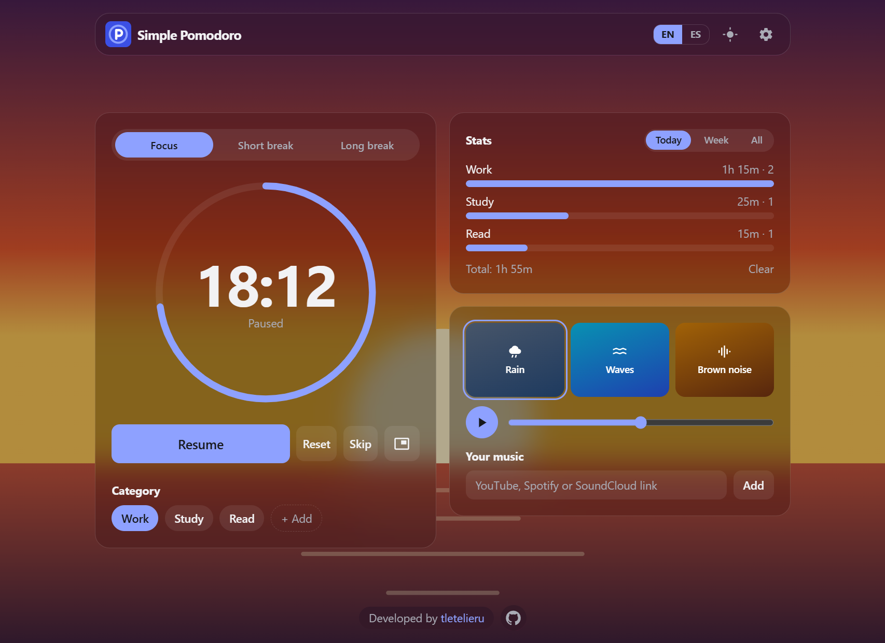

# 🍅 Simple Pomodoro

A Pomodoro timer you just open and use. Tag your focus sessions, see where your time goes, and make
it look the way you like.

**No account and no backend.** Your sessions and settings stay in your browser.

**[Open Simple Pomodoro →](https://tletelieru.github.io/simple-pomo/)**



_Screenshot made with invented sessions._

## What you get

- **Timer:** focus, short break and long break, with a long break every few rounds. Durations and
  rounds are yours to set
- **Pause and resume:** look at another mode without losing the session in progress. A running timer
  also survives a page reload
- **Categories:** tag each session as Work, Study, Read or your own
- **Stats:** focus time and session count per category, for today, this week or all time
- **Time display:** minutes and seconds, minutes only, or minutes with seconds in the last minute
- **Floating timer:** keep the countdown on top of other apps, where the browser supports
  Picture-in-Picture
- **Ambience:** rain, waves and brown noise, generated in the browser
- **Your music:** paste a YouTube, Spotify or SoundCloud link
- **Your look:** backgrounds with dim and blur, glass cards, a main color and an optional animated ring

You can also turn on auto-start, a completion sound and notifications, and export or import your
data as JSON.

Available in English and Spanish, with light and dark mode. Install it as an app and the timer works
offline.

## Good to know

- Data lives in one browser. Use export and import to move it to another device.
- Browsers slow down hidden tabs. The time stays correct, but the sound or notification can arrive
  when you come back.
- Phones close the floating timer when the screen locks, and they control its size.
- On phones, ambience and embedded players can stop when you leave the page. Spotify plays previews
  unless you are logged in to it in that browser.
- Your music needs an internet connection and does not follow the timer.

## Run it locally

Developed with Node 24 and pnpm 9.

```sh
pnpm install
pnpm dev
```

| Command          | What it does                               |
| ---------------- | ------------------------------------------ |
| `pnpm test`      | Runs the unit tests                        |
| `pnpm lint`      | Runs ESLint                                |
| `pnpm typecheck` | Runs the type checks                       |
| `pnpm build`     | Builds the site                            |
| `pnpm preview`   | Serves the build                           |
| `pnpm gen:icons` | Generates the PWA icons from `favicon.svg` |

The service worker only runs in a build, so test installing and offline mode with `pnpm build` and
`pnpm preview`.

## How it works

The timer stores when a block ends instead of counting ticks, so it stays right when the tab sleeps.
Timer rules, saved data and link parsing are plain functions in `src/lib`, and the floating timer
draws on a canvas streamed into a Picture-in-Picture video.

Built with React, TypeScript, Vite, Tailwind CSS and `vite-plugin-pwa`. Merges to `main` deploy to
GitHub Pages through GitHub Actions.

All UI text lives in `src/i18n/messages.ts`. Backgrounds and ambience are original, and `CREDITS.md`
explains how to add more.

---

Developed by [tletelieru](https://tletelieru.github.io/tletelieru/) · [GitHub](https://github.com/tletelieru)

## License

[MIT](LICENSE)
